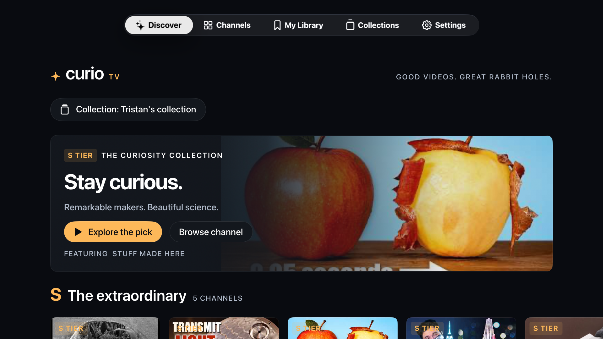

# CurioTV

A native Apple TV browser for a very good corner of YouTube.

CurioTV brings the 156 channels in [Tristan Hume's November 2026 tier list](https://thume.ca/2026/11/01/youtube-tier-list-2026/) to a remote-friendly tvOS interface. Inspired by [Andrej Karpathy's TristanTube post](https://x.com/karpathy/status/2119114537442189652).

Browse by tier, search channels and article picks, favorite channels, and save videos locally. The original collection includes 136 suggested starting videos. Recent uploads use public channel feeds when available.

Create your own collections for different interests or people. Add channels by link or @handle, copy whole groups, move one or many channels between tiers, and set optional channel-count limits per tier. Edit inside CurioTV with the remote or iPhone keyboard. The original list stays intact. See the [curation guide](docs/curation.md).



**Choose a video in CurioTV; watch it in the official YouTube app.** Sign in there to use your account and its history settings or Premium benefits. CurioTV does not authenticate with Google, play videos itself, or synchronize YouTube history. Its “opened links” list records successful handoffs, not viewing time.

## Run it

Requires a Mac with Xcode 26 or newer, Swift 6.2 or newer, and a tvOS 26+ simulator or Apple TV. The exported app was validated with Xcode 27 and tvOS 27; see [validation](docs/validation.md).

1. Clone [this repository](https://github.com/eliasnema/CurioTV), open `CurioTV.xcodeproj`, and select the **CurioTV** scheme.
2. Select an Apple TV simulator and run. No server, API key, or account setup is needed for browsing.
3. For a physical Apple TV, set your signing team and change the example bundle IDs (`com.example.CurioTV` and its UI-test target) to your own unique identifiers. Enable Developer Mode and pair the Apple TV with Xcode.
4. Install the official YouTube app on your Apple TV and sign in there. The simulator normally has no YouTube app, so CurioTV shows a link and QR code when handoff is unavailable.

Favorites and saved links stay on this Apple TV. See [privacy](PRIVACY.md).

## What is included

| Location | Purpose |
| --- | --- |
| `CurioTV/` | SwiftUI tvOS app, remote focus, local library, YouTube handoff |
| `Sources/CurioCore/` | Catalog, collection rules and caps, public-feed discovery, Atom parser, validated links, persistence |
| `Tests/CurioCoreTests/` | Offline core checks and feed fixture |
| `CurioTVUITests/` | Remote navigation, collection editing and limits, save/relaunch, handoff failure, settings |
| `Scripts/` | Project/artwork generators, catalog import, public-export check |
| `docs/possible-playback-bridge.md` | Separate, experimental design proposal only |
| `docs/write-up-draft.md` | Short accompanying article draft |

The bridge proposal explores how in-app playback and account history might fit together. **No bridge implementation, account credentials, stream resolver, or history-writing code is shipped here.** It is not an available setting or supported feature.

## Current limits

- Public feeds can fail or return HTTP 404. The app reports that failure and keeps the bundled article pick and **Open channel in YouTube** action available.
- Feed metadata does not include duration. The Shorts filter uses the Shorts link supplied by YouTube.
- Feed discovery for custom handles is best effort. Collections and the shared local library do not provide parental access controls or separate account profiles.
- Opening a YouTube link does not prove that the video played or entered watch history. Account selection, paused history, and playback are controlled by YouTube.
- This is a source release candidate for building yourself; there is no App Store or TestFlight distribution.

## Development

```sh
swift test
python3 Scripts/check_public_export.py
xcodebuild -project CurioTV.xcodeproj -scheme CurioTV \
  -destination 'generic/platform=tvOS Simulator' \
  CODE_SIGNING_ALLOWED=NO ARCHS=arm64 ONLY_ACTIVE_ARCH=YES build
```

Run UI tests on a booted Apple TV simulator through Xcode's Test action. Live feed selection may skip when the external feed is unavailable; offline parsing is tested separately. GitHub Actions runs core tests, the export check, and an unsigned simulator build; account and live-feed tests are not part of CI.

The Xcode project and icon artwork are checked in. Regenerate them with `python3 Scripts/generate_project.py` and `swift Scripts/make_assets.swift`. Project generation restores the example signing settings. To refresh the catalog, save the original article as HTML and run `python3 Scripts/import_catalog.py path/to/article.html`; reviews and article prose are not imported.

## Credits and license

Tristan Hume made the channel selection, tiers, and article picks. Karpathy's [TristanTube](https://karpathy.ai/tristan-tube/) suggested the interface opportunity; CurioTV is an independent tvOS implementation. The channels and videos belong to their respective creators.

Original CurioTV code and artwork are [MIT licensed](LICENSE). That license does not relicense third-party editorial selections, titles, thumbnails, videos, or trademarks. See [NOTICE](NOTICE.md). Built with assistance from Codex. No affiliation with YouTube, Google, Apple, Tristan Hume, or Andrej Karpathy is implied.
