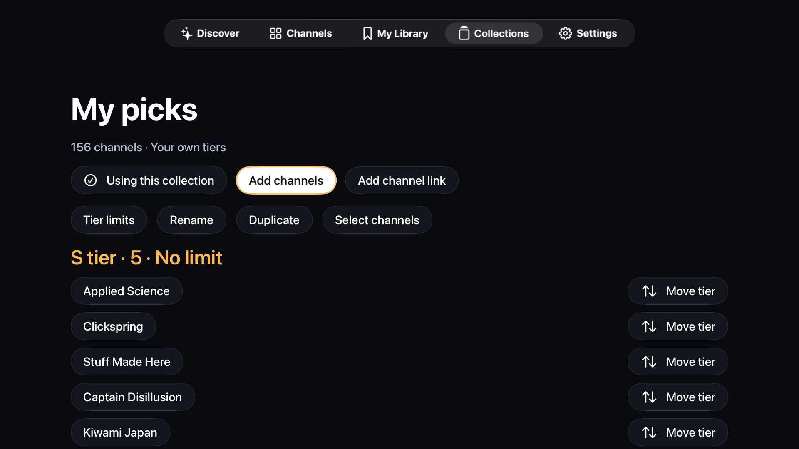
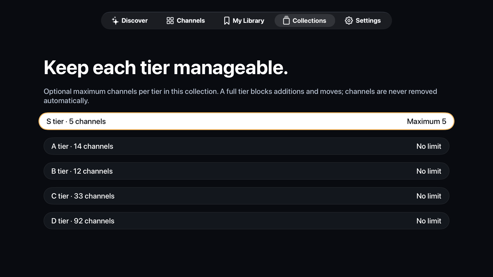

# Curate your own channels

Everything below works inside CurioTV. Use the Apple TV remote; text fields also support Apple's iPhone keyboard when your devices offer it.

## Make a collection

Open **Collections → New collection**. Give it a name, such as “My picks” or “Family picks”. Start empty, or enable **Start with Tristan's 156 channels** to make an editable copy. Creating a collection selects it for Discover and Channels.

Each collection has its own channel membership, rankings, and limits. The same channel can be S in one collection and B in another. Tristan's bundled list stays intact and always remains selectable.

## Add channels and groups

Open your collection and choose **Add channels**. Search the source list and select individual channels, or use **Select all shown** to copy a group in one operation. **From** can switch between Tristan's list and another personal collection.

Choose **Keep tiers** to preserve the source rankings, or choose S–D to place the selection in one tier. Select **Add selected** to save. Matching channel IDs or links are updated rather than duplicated. If a limit would be exceeded, the entire operation is rejected and nothing changes.

For a channel outside these lists, choose **Add channel link**. Enter a name and a YouTube channel URL, @handle, or UC channel ID, then choose a tier. Video and playlist links are rejected. CurioTV looks for a public RSS link advertised by the channel page when a handle needs a feed ID. This is a best-effort lookup; the channel still opens in YouTube if feed discovery is unavailable.

Google can return a consent page instead of public metadata. If that happens, a canonical `/channel/UC…` link can supply the feed ID directly; a handle-only entry can still open the channel in YouTube.

You can also open any channel page and select **Add or move in collections** to assign it directly to a tier in one or more collections.

## Change rankings

Choose **Move tier** beside a channel for a single change. To move several together, choose **Select channels**, select the rows or **Select all**, then **Move to S**, **Move to A**, and so on. **Remove** removes selected channels from this collection only.

Use **Rename**, **Duplicate**, or **Delete collection** to manage groups. Duplicating copies the channels, rankings, and limits into an independent collection. Deleting the selected collection switches browsing back to Tristan's list.

## Set tier limits

Open **Tier limits**, then choose a tier. Pick a preset, enter a **Custom maximum**, or choose **No limit**. Limits count channels, not videos or viewing minutes, and apply only within that collection.

For example, S can hold at most five channels while A holds ten. A full S tier blocks a new addition or promotion. Move a channel out or increase its limit first. Lowering a limit below the current count is rejected; channels are never demoted or removed automatically.

## Browse and save

Use the **Collection** button in Discover or Channels to switch groups. The selection survives relaunch. In Collections, **Use Tristan's collection** returns to the original list.

Collections and custom channels stay on this Apple TV. Saved videos, favorites, and opened links are shared local-library features across collections. Collections are a browsing tool, not parental access controls or separate YouTube accounts. Playback still opens the official YouTube app with whichever account is selected there.

**Settings → Reset local library** clears personal collections and the other local-library data after confirmation. The bundled original list remains available. No cloud sync or import from a YouTube account is included.
