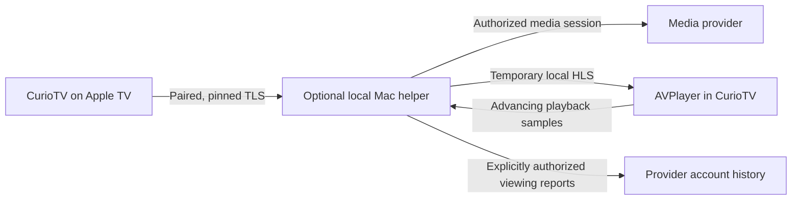

# A possible playback bridge

**Status: experimental design proposal. No implementation is included in this repository.** The app currently opens the official YouTube app. This document is not an installation guide or a claim that a public YouTube integration has been approved.

The question is whether CurioTV could retain its native interface during playback while a user's actual viewing also appears in their YouTube history. Account sign-in alone would not establish that behavior.

## Proposed boundary

The helper would be a separately distributed project with its own lifecycle, dependencies, permissions, and tests. CurioTV's curated browser would continue to run without it. It would not require a hosted service or upload a library to the app developer.

Discovery could use Bonjour, followed by a short-lived pairing code and certificate pinning. The TV would retain only a revocable helper credential in Keychain. A supported provider authorization flow would happen with the provider; passwords would never pass through CurioTV. Provider credentials could remain in helper memory, with reconnect required after restart.

Where the provider expressly permits it, the helper could supply a temporary HLS session to AVPlayer. Controls would use authenticated TLS. Any separate media route would need a scoped, short-lived capability, a bounded lifetime, and no reusable provider credentials in URLs or logs. Stopping playback would close the session and remove temporary media. The Mac would need to remain awake and reachable.

## History must follow actual playback

A proposed history adapter would require a supported, authorized provider interface. It should:

1. Obtain consent for writing viewing activity and establish a before-playback baseline.
2. Require both delivered media and advancing player samples. Preparing a stream or pressing Play must not count as watched.
3. Credit elapsed viewing conservatively, bounded by wall-clock time; exclude pauses, buffering, and seek jumps.
4. Submit periodic viewing reports only while playback advances. Stop reporting on cancellation, disconnect, or session expiry.
5. Check history afterward. Distinguish “report accepted” from an independently observed new history entry. An anonymous control must submit no account activity.

Resume position, deletion, multiple accounts, reconnection, expiry, and Premium/ad behavior would each need separate tests. A successful history entry would not establish all of them.

## The unresolved YouTube part

Google documents that watch-history playlists are unavailable through the [public YouTube Data API](https://developers.google.com/youtube/data/revision_history). There is no documented Data API method for recording arbitrary external playback as YouTube watch history. Adding OAuth to this app would not create one.

An unofficial adapter would introduce an unstable service dependency and permission questions. Google's [developer policies, section III.D.7](https://developers.google.com/youtube/terms/developer-policies#d.-accessing-youtube-api-services) require express permission for undocumented APIs. Those issues would need resolution before offering a YouTube bridge publicly. This proposal supplies no borrowed client credentials, undocumented endpoint recipe, stream extraction, or account-history implementation.

The account and media adapter is therefore an open dependency, not a completed component. There is no promise of ad-free playback or inherited Premium rights through a custom player. Until an appropriate integration exists, the official YouTube app remains the implemented playback path.

References checked 7 November 2026. This note is an architectural possibility, not a release commitment.
